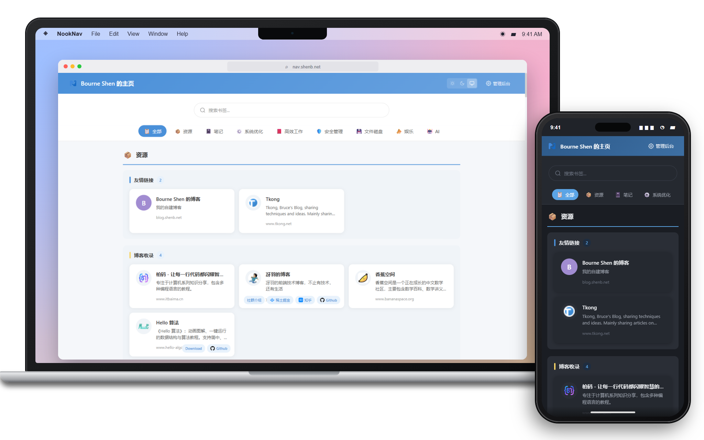
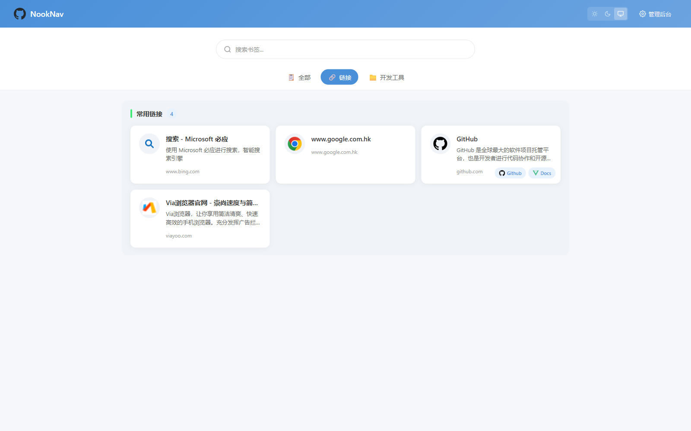
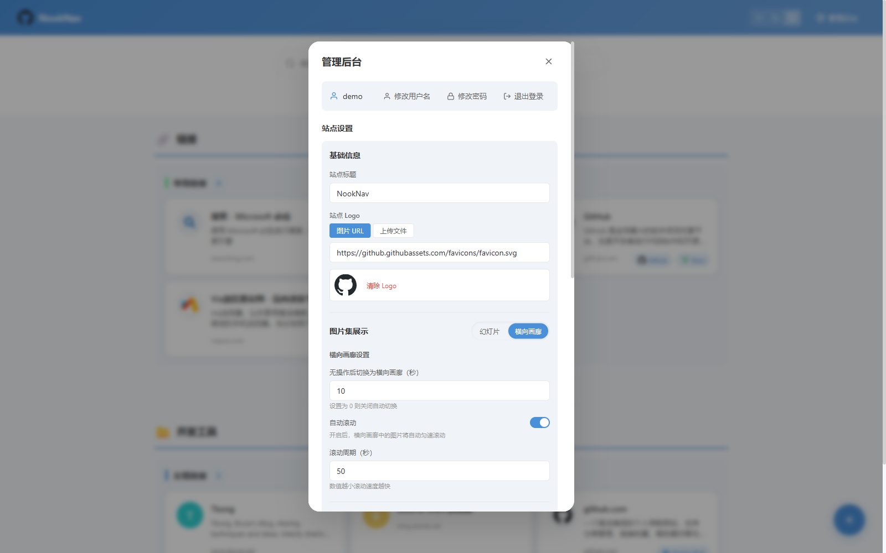
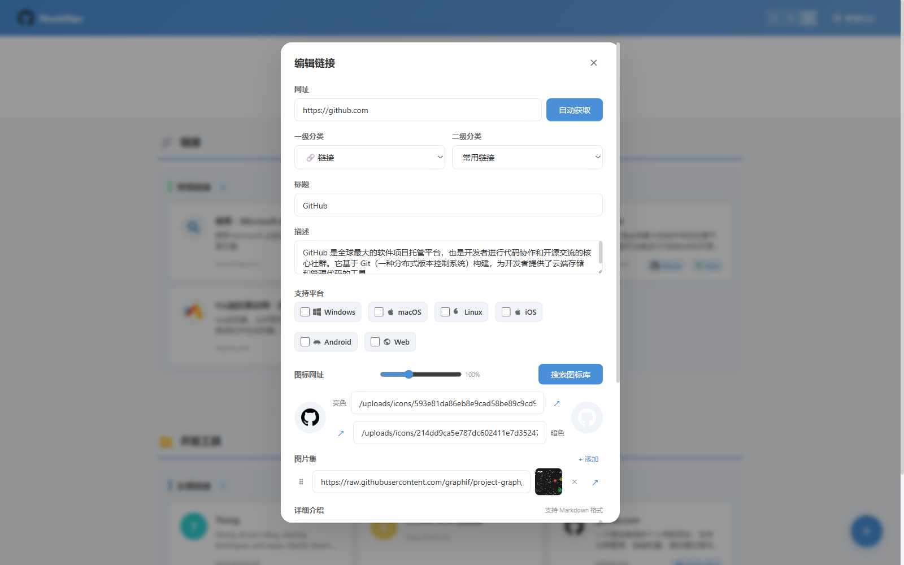
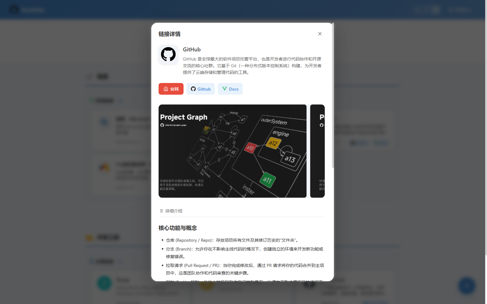

<div align="center">
  

<a id="nooknav"></a>

# 🧭 NookNav

个人导航与链接收藏站：按分类整理网站，用图文卡片展示工具、资源和服务。

[](https://github.com/shenbourne/NookNav)
[](https://hub.docker.com/r/shenbourne/nook-nav)

[在线演示 / 个人主页](https://nav.shenb.net/) · [个人博客](https://blog.shenb.net/) · [Docker 部署](#docker-deployment) · [本地开发](#local-development)

</div>

[](https://nav.shenb.net/)

NookNav 基于 Vue 3 与 Express 5 构建，提供公开浏览页面和登录后的管理界面。数据存储在本地 JSON 文件中，无需安装数据库；通过 Docker 部署时，一个数据目录即可保存导航内容、账号配置和上传文件。

<a id="contents"></a>

## 📑 目录

- [功能特性](#features)
- [部署与使用](#deployment)
- [配置与安全](#configuration)
- [数据存储](#storage)
- [开发指南](#development)
- [许可证](#license)

<a id="features"></a>

## ✨ 功能特性

<a id="navigation-search"></a>

### 🔎 导航与搜索



- **两级分类**：用一级分类和二级分类组织链接，支持 Emoji 分类图标。
- **双布局**：在分页布局和一栏流式布局之间切换。
- **全局搜索**：按标题、描述和 URL 查找链接。
- **主题切换**：支持亮色、暗色和跟随系统，链接可单独设置暗色图标。
- **卡片浏览**：悬停查看完整标题与描述，点击打开详情。

<a id="backend-management"></a>

### ⚙️ 后台管理



- **分类与链接管理**：新增、编辑、删除、拖拽排序和跨分类移动。
- **元数据抓取**：输入网址后获取网站标题、描述和图标。
- **图标检索**：集成自定义 CDN、Dashboard Icons 和 LobeHub Icons。
- **站点设置**：修改站点标题和 Logo，浏览器标签页图标同步更新。
- **账号管理**：登录后修改管理员用户名和密码。
- **关于应用**：查看应用图标、名称和当前版本，手动检查 GitHub 正式版更新。Docker 部署只提示新版本，由管理员更新镜像。

<a id="card-editor"></a>

### 📝 卡片编辑



- 设置标题、网址、纯文本描述以及亮色、暗色图标。
- 标记 Windows、macOS、Linux、iOS、Android、Web 等支持平台。
- 添加图片集并拖拽排序。
- 使用 Markdown 编写详细介绍。
- 添加自定义快捷按钮，通过 Simple Icons 选择按钮图标。

<a id="card-information"></a>

### 🪪 卡片详情



- 展示图标、标题、简介、平台标签和 Markdown 详细介绍。
- 通过官网按钮和自定义按钮直达相关页面。
- 图片集支持幻灯片与横向画廊，可配置自动切换和自动滚动。

<a id="deployment"></a>

## 🚀 部署与使用

<a id="docker-deployment"></a>

### 🐳 Docker 部署

准备 Docker 和 Docker Compose，在部署目录创建 `docker-compose.yml`：

```yaml
services:
  nav-site:
    image: shenbourne/nook-nav:latest
    ports:
      - '3000:3000'
    volumes:
      - ./backend/data:/app/data
    environment:
      NODE_ENV: production
      NAV_JWT_SECRET: ${NAV_JWT_SECRET:-}
      NAV_ADMIN_PASSWORD: ${NAV_ADMIN_PASSWORD:-}
      TRUST_PROXY: ${TRUST_PROXY:-}
    restart: unless-stopped
```

在该目录启动服务并查看首次启动日志：

```bash
docker compose up -d
docker compose logs nav-site
```

打开 [http://localhost:3000](http://localhost:3000)。远程部署时，将 `localhost` 替换为服务器地址。

镜像地址为 [`shenbourne/nook-nav:latest`](https://hub.docker.com/r/shenbourne/nook-nav)。仓库中的 [docker-compose.yml](docker-compose.yml) 还包含健康检查，可直接使用。

<a id="first-login"></a>

### 🔑 首次登录

首次启动会自动创建管理员账号：

- **用户名**：`admin`。
- **密码**：随机生成，仅在账号创建时的启动日志中输出；登录后在后台修改。

要指定初始密码，在 Compose 文件同目录的 `.env` 中设置 `NAV_ADMIN_PASSWORD`，再启动服务。密码至少 12 个字符，不能与用户名相同，也不能使用常见弱口令。

`NAV_ADMIN_PASSWORD` 仅用于首次创建账号，修改它不会重置已有账号的密码。账号配置保存在数据目录的 `auth-config.json` 中，该文件已排除出版本控制。

<a id="image-migration"></a>

### 🔄 更新与旧镜像迁移

更新前备份数据目录，然后在 Compose 文件所在目录执行：

```bash
docker compose pull
docker compose up -d
```

从 `shenbourne/nav-site` 迁移时，将镜像地址改为 `shenbourne/nook-nav:latest`，保留原数据卷挂载，再执行上述命令。已有账号和导航内容随数据目录保留；旧版公开的默认凭据会在启动时自动轮换，请检查启动日志。

<a id="configuration"></a>

## 🔐 配置与安全

<a id="environment-variables"></a>

### 🔧 环境变量

| 变量                 | 用途             | 默认行为与要求                                                                   |
| -------------------- | ---------------- | -------------------------------------------------------------------------------- |
| `NAV_ADMIN_PASSWORD` | 初始管理员密码   | 留空则随机生成；仅首次创建账号时使用，至少 12 个字符，并通过服务端密码校验       |
| `NAV_JWT_SECRET`     | JWT 签名密钥     | 留空则自动生成并持久化；手动设置时至少 32 字节，首尾不能有空格；更换后旧令牌失效 |
| `TRUST_PROXY`        | 可信反向代理配置 | 默认不启用；只有一层可信反向代理时设为 `1`，多层代理按实际拓扑配置               |
| `PORT`               | 后端监听端口     | 直接启动默认 `3000`；开发脚本设为 `4000`；容器内更改时同步调整端口映射和健康检查 |
| `NAV_DATA_DIR`       | 后端数据目录     | 默认使用后端目录下的 `data`；容器内为 `/app/data`                                |

Docker Compose 从同目录的 `.env` 读取变量。直接运行 Node.js 时，通过终端或进程管理器设置环境变量。

<a id="security-measures"></a>

### 🛡️ 内置安全措施

- 管理接口使用 JWT 认证，密码以 bcrypt 哈希保存。
- 修改用户名或密码后，已签发的旧令牌失效。
- 登录接口按 IP 和账号限流，服务端校验密码强度。
- 启动时检测并轮换旧版公开的签名密钥和默认密码。
- 元数据抓取与远程图片下载校验目标地址，拒绝内网、回环、链路本地和云元数据地址，并检查重定向目标。
- Logo 上传校验文件头，只接受 PNG、JPEG、GIF、WebP。
- Markdown 和图标 SVG 在渲染前进行白名单净化。

<a id="storage"></a>

## 💾 数据存储

<a id="image-storage"></a>

### 🖼️ 图片本地存储

后台「图片存储」提供两个独立开关：**图标本地存储默认开启，图片集本地存储默认关闭**。

开启后，已有和后续新增、编辑的远程图片会在后台转换为 WebP，服务启动时也会补齐缺失副本。后台展示处理进度和失败详情，并支持重试。

原图网址始终保留，编辑时可通过网址栏末尾的按钮打开原图。关闭本地存储后恢复使用原网址，本地副本保留，再次开启时复用；转换失败时继续显示原图，不影响链接保存。

| 项目           | 处理方式                                                           |
| -------------- | ------------------------------------------------------------------ |
| 亮色与暗色图标 | 保存到 `uploads/icons/`，使用无损 WebP；旧有损缓存从原网址重新生成 |
| 图片集         | 保存到 `uploads/gallery/`，转换为 WebP                             |
| 输入格式       | 支持常见位图、SVG、ICO，保留透明度及可解码的 GIF/WebP 动画         |
| 处理限制       | 单图下载上限 10 MB，解码上限 4000 万像素，仅接受 HTTP(S) 公网地址  |

<a id="backup-restore"></a>

### 📦 备份与恢复

默认数据目录为 `backend/data/`，容器内对应 `/app/data`：

```text
backend/data/
├── nav-data.json       # 导航内容与站点设置
├── auth-config.json    # 管理员账号与认证配置
└── uploads/            # Logo、图标和图片集本地副本
```

备份时先停止服务，再复制整个数据目录，完成后重新启动。恢复时停止目标服务，将备份放回挂载目录，再启动服务。保留 JSON 文件和 `uploads/`，才能同时恢复内容、账号及本地图片。

<a id="development"></a>

## 🛠️ 开发指南

<a id="local-development"></a>

### 💻 本地启动

使用 Node.js 22.12+ 和 npm。以下命令从克隆仓库开始，安装根目录、后端和前端三处依赖：

```bash
git clone https://github.com/shenbourne/NookNav.git
cd NookNav
npm ci
npm ci --prefix backend
npm ci --prefix frontend
npm run dev
```

根目录的 `npm run dev` 同时启动前后端：

| 服务 | 地址                                           | 说明                                      |
| ---- | ---------------------------------------------- | ----------------------------------------- |
| 前端 | [http://localhost:5173](http://localhost:5173) | 浏览和管理入口                            |
| 后端 | [http://localhost:4000](http://localhost:4000) | API 服务，由前端代理 `/api` 和 `/uploads` |

开发环境沿用前文的首次登录规则，初始密码在后端终端日志中查看。要单独启动某个服务，在根目录执行 `npm run dev --prefix backend` 或 `npm run dev --prefix frontend`。

<a id="build-checks"></a>

### ✅ 构建与检查

在项目根目录执行：

```bash
npm run build
npm run lint
npm test --prefix backend
npm run format:check
```

`npm run build` 输出到 `frontend/dist/`。直接运行后端时，将该目录的内容复制到 `backend/public/`，再执行 `npm start`，通过 [http://localhost:3000](http://localhost:3000) 访问。Docker 多阶段构建自动完成前端构建和文件复制。

`npm run format` 会格式化整个仓库；仅检查格式时使用 `npm run format:check`。

<a id="project-structure"></a>

### 🗂️ 项目结构

```text
frontend/
├── public/                    # 静态资源
└── src/
    ├── components/             # 导航、卡片、布局及管理弹窗
    └── stores/                 # Pinia 状态与 API 调用
backend/
├── server.js                  # Express 入口与 API 路由
├── services/
│   ├── data-store.js          # JSON 数据读写与排序
│   ├── meta-fetcher.js        # 网页元数据与图标检索
│   └── image-storage.js       # 图片下载、转换与缓存
└── tests/                     # 后端测试
demo/                          # 界面截图
Dockerfile                     # 多阶段镜像构建
docker-compose.yml             # 容器部署配置
```

数据读写统一通过 `DataStore`，前端状态与请求由 Pinia stores 管理。

<a id="technology-stack"></a>

### 🧩 技术栈

| 模块       | 技术                                                 |
| ---------- | ---------------------------------------------------- |
| 前端       | Vue 3、Pinia、Vite 7、Axios、vuedraggable            |
| 内容与图标 | Marked、Simple Icons、Dashboard Icons、LobeHub Icons |
| 后端       | Express 5、JWT、bcryptjs、Multer、Cheerio            |
| 图片处理   | Sharp、decode-ico                                    |
| 存储与部署 | JSON 文件、Docker、Docker Compose                    |
| 检查与测试 | ESLint、Prettier、Vitest                             |

<a id="api-overview"></a>

### 🔌 API 概览

API 响应统一使用 `{ success, data?, error? }`。除登录、公开读取和健康检查外，下表接口均需管理员认证。

| 方法                | 路径                                                                        | 用途                   |
| ------------------- | --------------------------------------------------------------------------- | ---------------------- |
| GET                 | `/health`                                                                   | 服务健康检查，无需认证 |
| POST                | `/api/auth/login`                                                           | 登录，无需认证         |
| GET                 | `/api/auth/check`                                                           | 检查登录状态           |
| PUT                 | `/api/auth/password`、`/api/auth/username`                                  | 修改账号凭据           |
| GET                 | `/api/categories`                                                           | 公开读取分类与链接     |
| POST / PUT / DELETE | `/api/categories` 及其分类、子分类、链接资源路径                            | 创建、修改与删除内容   |
| PUT                 | 各级资源下的 `/reorder`                                                     | 调整排序               |
| POST                | `/api/subcategories/move`、`/api/links/move`                                | 跨分类移动内容         |
| GET                 | `/api/settings`                                                             | 公开读取站点设置       |
| PUT                 | `/api/settings`                                                             | 修改站点设置           |
| POST                | `/api/settings/logo`                                                        | 上传 Logo              |
| GET                 | `/api/settings/image-storage`                                               | 查询图片处理进度       |
| POST                | `/api/settings/image-storage/retry`                                         | 重试图片处理           |
| POST                | `/api/fetch-meta`                                                           | 获取网页元数据         |
| POST                | `/api/match-icons`、`/api/search-dashboard-icons`、`/api/search-lobe-icons` | 匹配或搜索图标         |

<a id="link-data-structure"></a>

### 📋 链接数据示例

以下示例展示卡片的主要内容字段：

```json
{
  "id": "lnk_example",
  "title": "示例网站",
  "url": "https://example.com",
  "description": "简短描述（纯文本）",
  "favicon": "https://example.com/favicon.ico",
  "faviconDark": "https://example.com/favicon-dark.png",
  "platforms": ["Windows", "macOS", "Linux"],
  "imageGallery": ["https://example.com/screenshot.png"],
  "detailDescription": "# 详细介绍\n\n支持 **Markdown** 格式",
  "customButtons": [
    {
      "id": "btn_docs",
      "label": "文档",
      "url": "https://example.com/docs",
      "iconSlug": "gitbook"
    }
  ]
}
```

<a id="license"></a>

## 📜 许可证

本项目采用 [GNU GPLv3](LICENSE.txt) 许可证。
